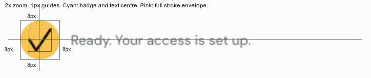
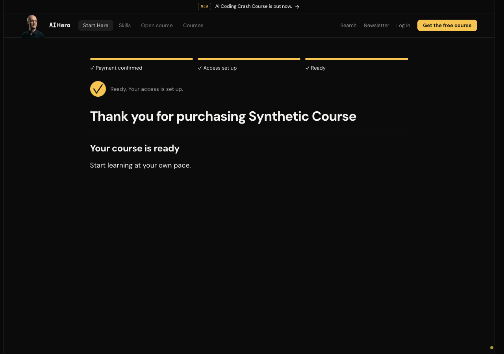
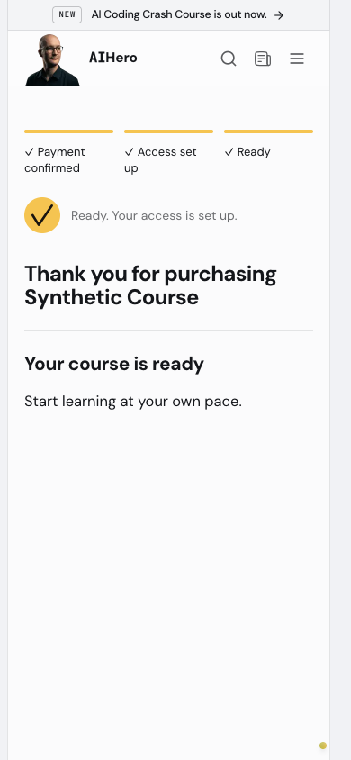
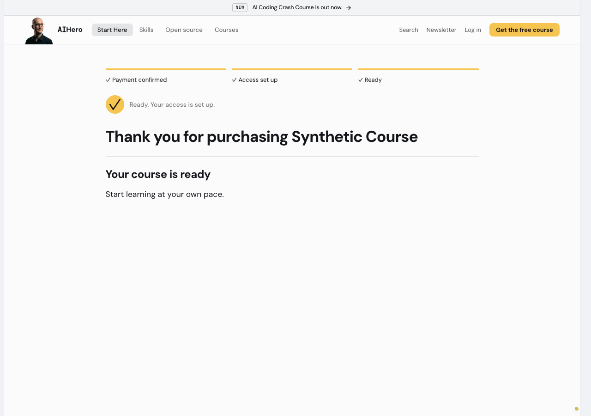
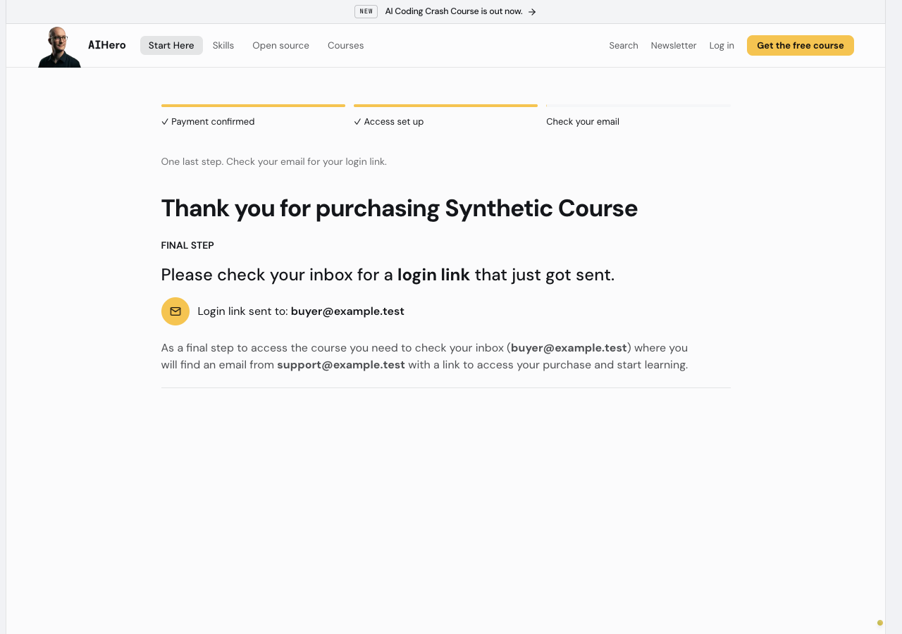
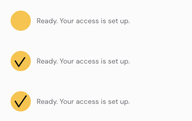

# Bigger ready checkmark, revision 2

The ready checkmark now has a 32px SVG frame in a 40px filled site-yellow circle. The login-link mail icon uses the same 40px circle and colour pair, retaining its 16px glyph. Both use `bg-accent-fill text-accent-fill-foreground`, so the fill and dark stroke remain the same in light and dark themes.

The tick points are normalized to square bounds rather than stretching the stroke. The final stroke envelope is 24px square, with 8px padding on all four sides. Round ends and joins remain uniform, at 2.667 CSS px. Ready still draws once in 300 ms. Mail still moves once in 400 ms. The existing redirect timing and heading focus are untouched. Reduced motion shows the completed, centred tick immediately.

## Fit and alignment proof

Measurements use the first rendered text line's DOM Range, not its surrounding span or line-height box. The ready row anchors the badge to that first line with a grid, so wrapping does not centre it on the entire text block. SVG geometry is mapped to screen coordinates, including half of the uniform round stroke. The measured values are in [alignment-v2.json](alignment-v2.json).

| Measurement | Light desktop | Dark desktop | Mobile 390px | Reduced motion |
| --- | ---: | ---: | ---: | ---: |
| Badge diameter | 40px | 40px | 40px | 40px |
| Badge centre minus text-line centre | 0px | 0px | 0px | 0px |
| Badge left minus content-column left | 0px | 0px | 0px | 0px |
| Text gap | 12px | 12px | 12px | 12px |
| Stroke padding, left/right/top/bottom | 8/8/8/8px | 8/8/8/8px | 8/8/8/8px | 8/8/8/8px |
| Horizontal overflow | 0px | 0px | 0px | 0px |

Alignment and padding differences are zero, inside the requested ±1px target. The mail comparison also measures a 40px circle and 12px gap. A 320px viewport was checked too, with the same zero offsets and no overflow.

The complete stroke has at least 3.58px radial clearance from the circular boundary. The draw animation only reveals subsets of that same fixed path, never scales or moves it, so that clearance applies to every animation frame, not only the three captured times. Reduced motion reports zero icon animations and preserves H1 focus.

### 2× crop with 1px guides

The guide overlay is added to a 2× crop of the real light screenshot. Cyan marks the badge bounds and the shared vertical centre of the badge and rendered text line. Pink marks the complete round-stroke envelope. Labels are CSS pixels, not the doubled output pixels.

## Same-method route JS

Unchanged baseline: main commit `b9d84acd`. Method is unchanged from revision 1: unique synchronous client-reference JS chunks plus `rootMainFiles`, with each asset gzipped separately at level 9. These are conservative webpack route payload measurements, not observed network-transfer counts or Next's removed First Load JS column.

| Route | Before, gzip bytes | V2, gzip bytes | Total added over baseline |
| --- | ---: | ---: | ---: |
| `/thanks/purchase` | 1,143,025 | 1,143,617 | 592 bytes |
| `/welcome` | 1,149,407 | 1,149,962 | 555 bytes |

Shared icon CSS is 898 raw bytes, 401 gzip bytes. Both route increases stay comfortably below 15 KiB. No new dependency or lockfile change.

## Checks

- 27 targeted tests pass across five suites, including badge size, token pairing, first-line layout, square stroke bounds, reduced motion and no-loop guards.
- Mutation proof repeated for v2: changing the checkmark to infinite iterations fails the test; restored source passes.
- Changed-file ESLint and source typecheck pass. The temporary local source config excludes existing generated Next route validators.
- Local webpack assets compiled, followed by the same pre-existing Kit webhook route export validation error. That route remains untouched. Hosted next build, CI and Vercel are the release gate for this PR.

## New synthetic frames

These use the real components under the app layout with synthetic props, not a new checkout or delivery test. The temporary preview route is not shipped. Revision 1 files are preserved for comparison.

### Ready, light

### Ready, dark

### Ready, mobile

### Reduced motion

### Mail badge comparison

### Three draw frames

Top to bottom: 0, 100 and 300 ms. The actual browser CSS animation was paused at those times, not replaced or lengthened.

