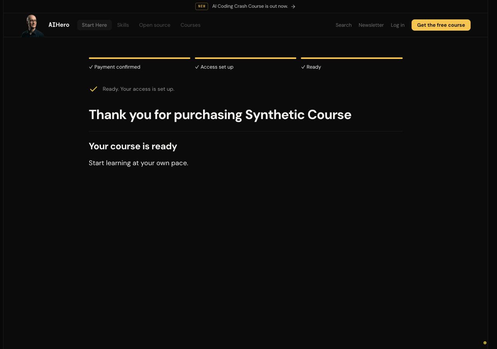
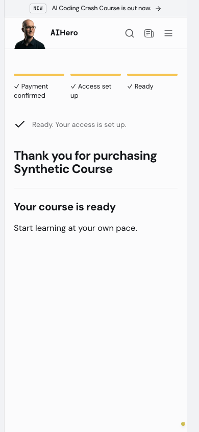
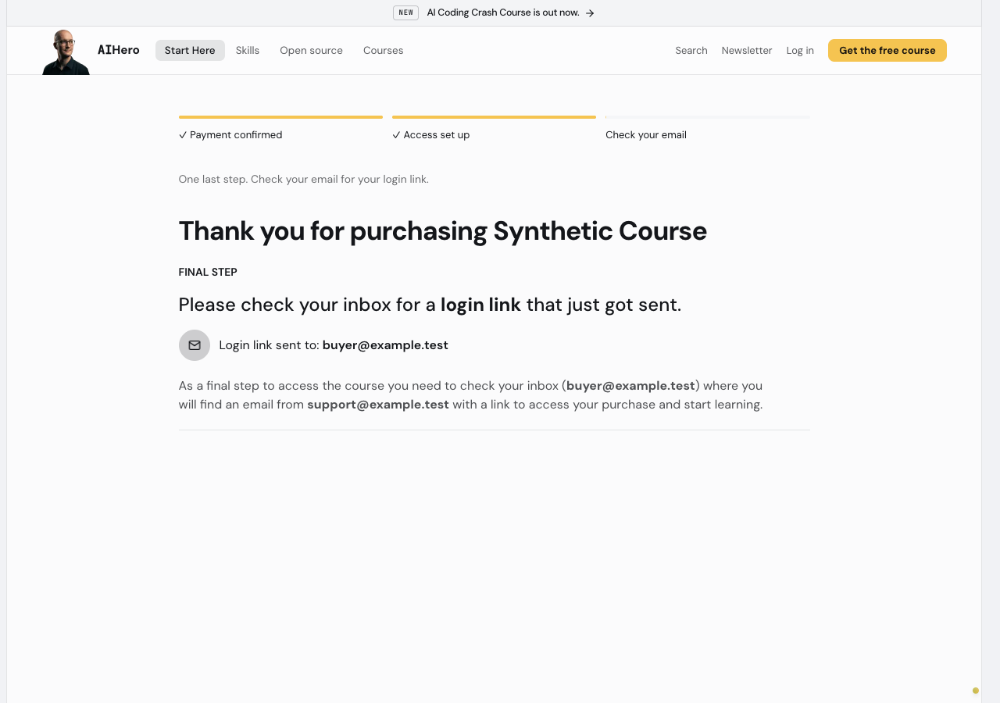
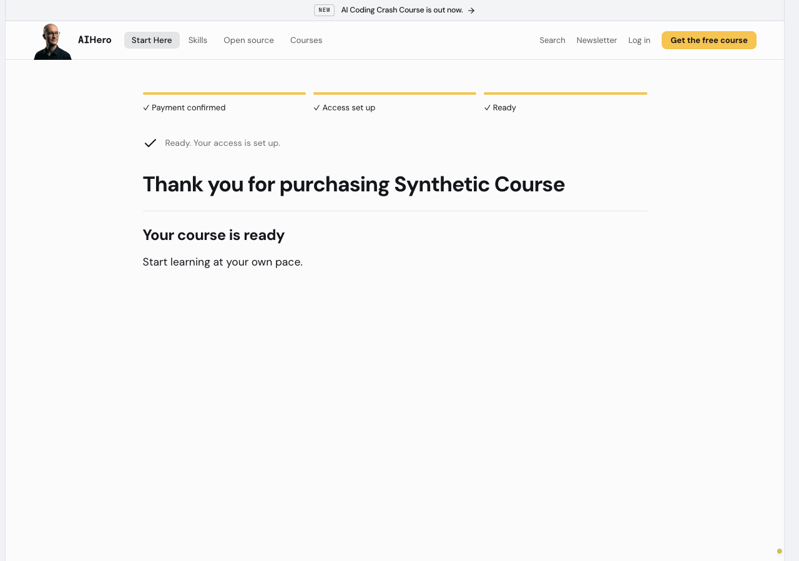
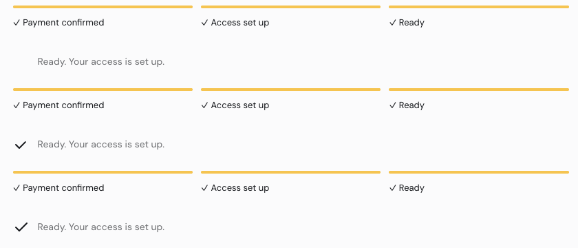

# Two post-purchase animation moments

Only the ready status and the login-link mail glyph gain motion. Polling, slow and failed states gain no animated icons. Existing live-region text, destination focus and navigation are unchanged.

## Install and licence

Two hand-ported inline SVGs from the official useAnimations checkmark and mail downloads. The artwork and code are MIT licensed according to [the publisher's terms](https://useanimations.com/licencing-and-terms). The complete notice and source URLs are in `post-purchase-icons.LICENSE` beside the components.

No dependency, player, Lottie JSON or lockfile change. Registry inspection found that its checkmark wrapper adds `react-useanimations@^3.1.1` and defaults to looping. npm metadata for 3.1.1 declares no dependencies; 2.10.0 declares `lottie-web`. The inline port avoids either player entirely. Its SVG branches render only at ready or the login-link step. This is the tiny-inline-SVG option, not a dynamic player import.

## What buyers see

- The ready checkmark draws once over 300 ms. The existing poller navigation fires at 350 ms and does not wait for animation. The destination gets a static checkmark when the poller already showed the payoff, so the handoff does not repeat it.
- A fast purchase that never mounted the poller plays the checkmark on welcome. No artificial wait is added before showing the course or focusing its heading.
- The mail icon moves upward by 2 px once over 400 ms beside the login-link address. It never loops.
- Reduced motion shows the completed checkmark or mail frame immediately, including before hydration. The existing reduced-motion poller redirect remains immediate, so its transient ready frame may not be visible. Welcome still shows the final static checkmark.
- Icons are decorative, with `aria-hidden` and `focusable="false"`. Stroke uses the app's `text-primary` token in both themes. Ready is 24 px; mail retains the original 16 px glyph in its 40 px circle.

## JS measurement beside the frames

Next 16.2.7 does not print the older First Load JS column. These are same-method, conservative route payload measurements from `next build --webpack`: the union of unique synchronous client-reference chunks and `rootMainFiles`, gzipping each asset separately at level 9. They include shared route dependencies, not just the icons, and are not a claim about observed network transfer.

Baseline is unchanged main `b9d84acd`. Both local builds compiled; both subsequently stopped on the same pre-existing invalid `validKitSignature` route export during Next's generated route type validation. No route validation was bypassed or repaired in this change. Hosted PR CI and Vercel remain the full build gate.

| Route              | Before, gzip bytes | After, gzip bytes |     Added |
| ------------------ | -----------------: | ----------------: | --------: |
| `/thanks/purchase` |          1,143,025 |         1,143,479 | 454 bytes |
| `/welcome`         |          1,149,407 |         1,149,824 | 417 bytes |

New shared icon CSS is 672 bytes raw, 276 bytes gzipped. Both JS deltas are well below 15 KiB.

## Verification

- 24 targeted Vitest tests across five suites passed: icon, shell, arrival, polling machine and purchase-details recovery.
- The no-loop test was mutation-checked: changing checkmark iteration count from `1` to `infinite` failed; restoring `1` passed.
- Changed-file ESLint passed.
- Full source typecheck passed with only the generated `.next` route validators excluded in a temporary local config. The normal typecheck still reports existing generated-route export errors, not icon errors.
- Browser reduced-motion ready: zero icon animations, final stroke offset `0px`, destination H1 focused.
- Browser normal motion: ready duration 300 ms and iteration count 1; mail duration 400 ms and iteration count 1. Both settle on their final frame. Mobile has no horizontal overflow.

## Synthetic component previews

These frames mount the real shell, arrival and login-link components under the app layout with synthetic props. They are UI and focus proofs, not checkout, entitlement, navigation or email-delivery proofs. No new paid checkout was needed for the icon-only change. Development toolbars are hidden. The preview route is temporary and is not shipped.

### Ready, light

### Ready, dark

### Ready, mobile

### Login-link step, light

### Reduced motion, final static ready frame

### Checkmark play, three frames

Top to bottom: 0 ms, 100 ms, 300 ms. The browser's actual CSS animation was paused at these times for capture, not replaced with a different animation or lengthened for screenshots.

